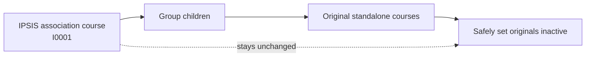
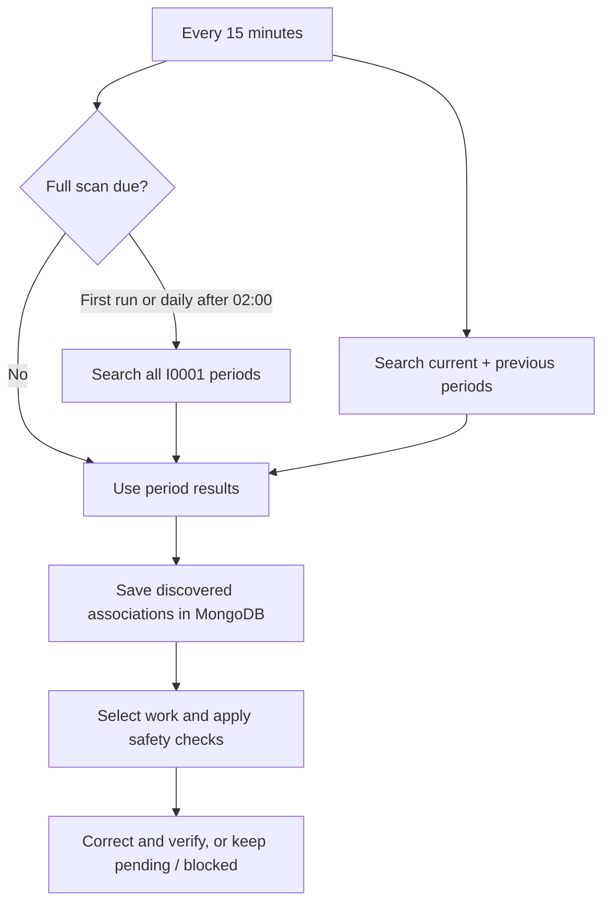

# Section Association Fix — Beginner's Guide

**Purpose:** Automatically find original Brightspace courses that were consolidated through IPSIS Section Associations, safely mark those original courses as inactive, and keep an audit trail.

## 1. Why does it exist?

When IPSIS groups multiple sections under a **Section Association Course Offering** (identified by `I0001`), the original standalone Course Offerings may remain active. The app finds these originals and deactivates them when their relationship to the association is unambiguous. **It does not delete courses, change enrollments, move groups, or alter the grouped course.**

## 2. The five main blocks

| Block | Plain-English responsibility |
| --- | --- |
| **Scheduler** | Wakes the worker up automatically. |
| **Discovery** | Finds `I0001` association courses, using smart academic-period searches. |
| **Resolver + safety checks** | Uses each association's Group codes to identify its original courses and verifies every match. |
| **Correction engine** | If live changes are enabled, deactivates active originals and reads them again to confirm. |
| **MongoDB + LTI monitor** | Remembers work and outcomes; displays execution history and downloadable reports to authenticated Brightspace users. |

Brightspace is the **source of truth** for course status. MongoDB is the app's work notebook. The worker uses a dedicated Brightspace service account; it does not require someone to open the LTI interface.

## 3. How does it find association courses efficiently?

The app determines academic periods automatically using **São Paulo time**:

- `YY01` = January–June; `YY02` = July–December.
- In **October 2026**, the current period is **2602** and the previous period is **2601**.
- Every 15 minutes, it searches association codes containing `2602-I0001` and `2601-I0001` (the exact periods change automatically).
- Once a day, **at or after 02:00**, it also searches **all** `I0001` periods to catch older, future, or otherwise missed associations. On first installation, this full search establishes the initial baseline.

**Why this matters:** frequent checks are lighter, but the daily complete search prevents older associations from being forgotten. A failed full search remains due for retry.

## 4. What makes a correction safe?

The app only acts when **all** of these conditions hold:

1. The association is a **Course Offering** with the exact code shape `123456-01-2026-I0001`.
2. It has at least one **direct Group child**; every child code ends in `-` plus **five digits**.
3. Removing each Group's final five-digit suffix identifies **exactly one distinct original Course Offering**. Duplicate, missing, or ambiguous matches block that association.
4. **Every target is validated before any course is changed.** Already-inactive targets are left alone.
5. In **live mode**, the only permitted course change is **Active → Inactive**, followed by a read-back verification. An uncertain update is not blindly repeated.

**Dry-run is on by default:** the app checks and reports what it *would* change, but makes **no course changes**. There is no automatic rollback.

## 5. What runs when?

| Timing (São Paulo) | What happens |
| --- | --- |
| **Every 15 minutes** | Find associations in the configured scope; automatic mode searches previous/current/next, while `all` searches every period. Process eligible work. |
| **Daily, at or after 02:00** | Full historical/future-period discovery for automatic and explicit scopes; `all` mode uses its regular broad query for this too. |
| **Every 4 hours** | Recovery of pending and retryable blocked work. |
| **03:00–06:00** | Recheck completed associations whose last successful verification is at least 24 hours old. |

A scheduled cron execution processes **at most 50 associations** across its normal and recovery work. One association can point to several original courses. Newly discovered associations usually wait **10 minutes** before processing; historical baseline associations do not.

Academic periods use `YY01` for January–June and `YY02` for July–December in `America/Sao_Paulo`. `SECTION_ASSOCIATION_DISCOVERY_PERIODS` is optional: leave it unset for automatic previous/current/next discovery, use a comma-separated period list to select specific periods, or set it to `all` for every fast cycle. No manual rollover is needed.

## 6. What can an administrator see?

The authenticated, **read-only** LTI monitor shows service status and the latest 50 executions. It offers **Export History CSV**, and for audited executions, **Corrections CSV** (verified changes) and **Exceptions CSV** (problems). Older executions may not have detailed reports. It does **not** currently provide a button for changing courses.

**In one sentence:** the app is an automated, cautious Brightspace housekeeping worker: it finds grouped-course originals, checks that each match is certain, deactivates only the eligible originals when live mode is enabled, and records what happened.
