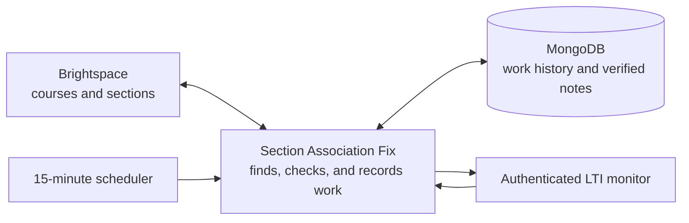
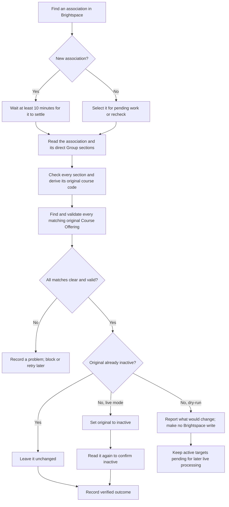
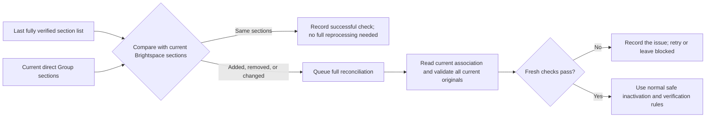
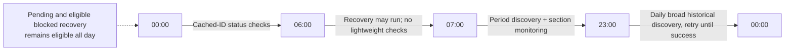

# Brightspace Section Association Fix: A Beginner’s Guide

This guide explains what the application does, how it decides which courses are safe to inactivate, and what an operator can see when it runs. It assumes you know the basics of Brightspace courses and sections, but not how software is built.

## 1. The problem it solves

An institution can use IPSIS to combine several class sections into one shared Brightspace course. Brightspace calls the combined course a **Section Association Course Offering**. Each section in that combined course may point back to an original, standalone Course Offering.

For example, three original offerings might be combined so instructors and learners use one shared course:

```text
Before association                     After association
BIO 210, Section 01  ─────────────┐
BIO 210, Section 02  ─────────────┼──► Shared BIO 210 course
BIO 210, Section 03  ─────────────┘
Original offerings may still be active
```

The original offerings can remain active after the association is created. That can leave duplicate or outdated courses available. This application finds the original offerings represented by the associated sections and, when live processing is enabled, marks those originals inactive. It leaves the shared course, its sections, enrollments, and mappings alone. It does not delete courses.

## 2. The application at a glance



| Part | What it does |
| --- | --- |
| **Brightspace** | Holds the current courses, association relationships, and active or inactive state. It is the source of truth. |
| **Section Association Fix** | Finds associations, checks their sections and original courses, and handles safe inactivation. |
| **Scheduler** | Starts bounded worker runs on a regular cadence. The local time determines which kinds of checks are eligible in each run. |
| **MongoDB** | Keeps a work ledger: which associations were seen, what was checked, verified relationships, and execution history. Saved notes help select work, but do not prove current Brightspace state. |
| **LTI monitor** | Gives authenticated Brightspace users a read-only view of service status, run history, health information, and available reports. It is optional and is not needed for the background worker to run. |

The worker connects to Brightspace with its service account. The monitor does not provide a button to inactivate courses.

## 3. How one association is processed



In plain terms, the application follows the section links back to the original courses. It checks **all** of those courses before changing any of them. A missing match, duplicate match, unexpected course type, or invalid section code stops that association from being changed. If an original is already inactive, that is a successful no-change result. In live mode, the worker reads back a changed course to confirm the result; it does not blindly repeat an update whose outcome is uncertain.

## 4. The recurring activities

These activities have different purposes. Finding an association, checking a saved association, and changing an original course are not the same thing.

### Discover associations

Discovery searches Brightspace for offerings whose Org Codes match the supported association formats. It searches selected academic periods during the day and performs broader searches for older or otherwise missed offerings at night. A found association is recorded in MongoDB so the worker can process it and remember its history.

Discovery does not create an association. It can only find an offering that IPSIS successfully created in Brightspace.

### Monitor the sections of known associations

During daytime monitoring, the worker checks the direct Group sections of previously reconciled associations against the last successfully verified section list. If a section was added, removed, or changed, the association is sent through the full processing checks again. A section being removed never causes an original course to be reactivated.

### Reconcile pending and recoverable work

Pending work includes newly discovered associations that have finished their waiting period. Blocked or failed work can be selected for recovery when due. In the production cron setup, recovery is checked on each scheduler invocation but normally runs about every four hours; an unfinished recovery remains due for a later invocation. Recovery uses the same validation and write safeguards as any other processing. A run has a shared limit of 50 full reconciliations, so remaining work waits for a later run.

### Search broadly for historical associations

Once daily, the worker searches both supported code families across periods, rather than querying the entire history on every run. The first successful broad pass also establishes the initial baseline in MongoDB. Being part of that baseline does not permanently exclude an association from later processing.

### Verify saved original-course IDs

Overnight, the worker checks saved original-course IDs to see whether those same Brightspace offerings still exist and remain inactive. These saved IDs are a shortcut for checking status only. If a course is active, missing, or inconsistent with the saved information, the worker must reread the current association and validate its current sections and exact original-course matches before a change is allowed.

### How monitoring leads to safe reprocessing



The stored list helps the worker notice change. It never gives permission to change a course by itself.

## 5. A day in the worker’s schedule

The production setup starts one cron invocation every 15 minutes, 24 hours a day. Each invocation checks the current time in **São Paulo** and runs the work that is eligible then. This does not mean every association is checked every 15 minutes: monitoring checks are spread across bounded batches, and some activities run only in particular windows.



| São Paulo local time | Work eligible in this window |
| --- | --- |
| **00:00–06:00** | Rotating status checks of saved original-course IDs. Suspicious results require full fresh reconciliation. |
| **06:00–07:00** | No discovery or lightweight monitoring. Pending and eligible blocked recovery may still run. |
| **07:00–23:00** | Period-based discovery and rotating checks of direct Group sections. |
| **23:00–00:00** | Broad historical discovery. It runs once successfully per day; if it fails or is incomplete, later 15-minute invocations retry during this window. |
| **All day** | Pending and eligible blocked recovery remains eligible. In cron mode, the recovery pass is normally due every four hours, checked at an invocation. |

Newly found associations normally wait **10 minutes** before processing, giving Brightspace time to finish creating their details. Historical baseline records do not wait. The regular discovery scope defaults to the previous, current, and next academic periods; an operator may configure a different scope. Broad historical discovery is a separate daily search and should not be confused with those regular period searches.

Section monitoring checks up to 125 associations per invocation by default. Cached-ID status checks handle up to 100. These are limits for each run, not promises that each record is checked at a fixed interval. Work beyond a run’s limit remains for later runs. Full reconciliation and recovery share a limit of 50 associations per invocation.

## 6. What happens in common situations?

### A new Section Association is created

The next eligible period search can find it. The worker records it, lets the 10-minute stability delay pass, then checks its sections and all matching original offerings. The association can be processed after it passes those checks.

### A section is added to an existing association

Daytime monitoring can detect the change by comparing the current section list with the saved verified list. The association goes through full checks again, including the new original course. Only after every match is validated can live processing inactivate an active original.

### An original course is already inactive

The worker leaves it unchanged and records that it was already compliant. It does not send a redundant change.

### A Brightspace request fails temporarily

The failed check is recorded and the worker retries eligible work later under its retry and recovery rules. A failed or partial discovery search cannot be used as proof that an association is absent. The latest known successful snapshots are preserved when a check fails.

### An association disappears or is deleted

A single “not found” response is only an initial observation. The worker keeps the record pending. It marks the association **missing** only after at least 30 minutes and a newer successful search for the same code family and academic period (or a successful broad search for that family) also omits the exact Brightspace ID. A legacy-code search cannot confirm a PeopleSoft-format record is missing, or the other way around. No Recycle Bin lookup is used. Missing records remain in history but leave the normal pending and recovery queues. If the same ID is later discovered again, it returns to pending; a different ID with the same Org Code is a separate record.

### An older academic period needs attention

Historical associations are eligible for reconciliation and do not have the new-association waiting delay. The daily broad search helps find older offerings without repeating an all-history search every 15 minutes. Discovery still depends on the offering existing in Brightspace.

## 7. Safety rules and limits

- **Dry-run is the default.** It performs checks and reports what would be changed, but sends no course updates. Active originals stay pending for a later live run.
- **Every target is checked before the first change.** If any original-course match is missing, duplicated, or invalid, the association is not partially processed.
- **Only one course property is changed.** In live mode, the application changes an original Course Offering from active to inactive. It does not delete, rename, or reactivate courses, and it does not change the associated course or enrollments.
- **A change is read back and verified.** If the result of an update is uncertain, the worker checks state rather than blindly sending the update again.
- **Saved MongoDB information is not authority to write.** Brightspace is the source of truth. A stored ID or section snapshot can select a record or flag a possible change, but current structure and exact matches must pass the normal validation before any write.
- **It cannot repair a failed IPSIS import.** The application does not create associations or courses. If IPSIS never created an offering in Brightspace, there is nothing for discovery to find.

## 8. Understanding the monitoring interface

The optional LTI page is authenticated and read-only. Its sections answer different operator questions:

### Service Status

Shows whether the service can report its state, whether the worker is currently running or idle, the configured discovery periods, and the latest recorded execution. A running worker is not necessarily making a course change; it may be discovering, checking, or doing no work.

### Execution History

Shows past executions, newest first, with the outcome and counts such as associations checked, already compliant, corrections applied, and errors. You can browse 50 at a time and filter by inclusive start dates. Expanding a run shows its brief summary. **Export History CSV** includes all retained executions, regardless of the current page or filters.

An execution marked **completed** means that run finished; it does not mean every association in Brightspace has been processed. **Failed** means the execution did not finish normally. **Skipped** generally means another worker held the shared work lease, so this invocation did not overlap it.

### API Health Check

Shows whether the configured Brightspace API version appears supported by the tenant and current version lifecycle information. It is a separate diagnostic and does not change courses or affect reconciliation. Results can be **Unknown** when evidence is stale or a check fails. Contract Verification is kept separate: a healthy version assessment is not proof that every request and response has been tested against Brightspace.

The check can run automatically and an authenticated operator can request a manual check. A manual request may be subject to a short cooldown or find another assessment already running. The page keeps the last successful evidence, but current health becomes Unknown after a failed attempt or when evidence is stale.

### Corrections and Exceptions reports

For executions with detailed audit information, the Reports menu offers:

- **Corrections CSV:** actual course changes that were read back and verified.
- **Exceptions CSV:** validation blocks, failed reads or updates, failed verification, unexpected processing errors, and confirmed-missing lifecycle entries.

Older executions may not have detailed reports; the interface labels those reports unavailable rather than implying that there were no changes or problems. Reports are generated from the saved execution record and do not make new Brightspace requests. Use the Exceptions report for operation-specific failure detail; the brief expanded history summary may not contain it.

## 9. Quick reference

- **Purpose:** find the original standalone offerings behind IPSIS Section Associations and safely inactivate eligible originals.
- **Scheduler:** one production cron invocation every 15 minutes, all day; each type of work follows its São Paulo time window.
- **07:00–23:00:** configured-period discovery and direct-section monitoring.
- **23:00–00:00:** broad historical discovery, with retries in the window until success.
- **00:00–06:00:** cached original-ID status checks.
- **All day:** pending and eligible blocked recovery; cron recovery is normally due every four hours.
- **New associations:** wait at least 10 minutes; historical baseline records do not.
- **Safeguard:** current association structure and every original target must validate before any write; cached information alone never authorizes a change.
- **Default mode:** dry-run, with zero Brightspace course updates.
- **Limit:** the application cannot create associations or fix failed IPSIS imports.

If a run reports a problem, check the execution summary and, when available, that run’s Exceptions CSV. For an older association that is not appearing, remember that broad discovery runs once daily, while an offering that IPSIS never created cannot be discovered.
