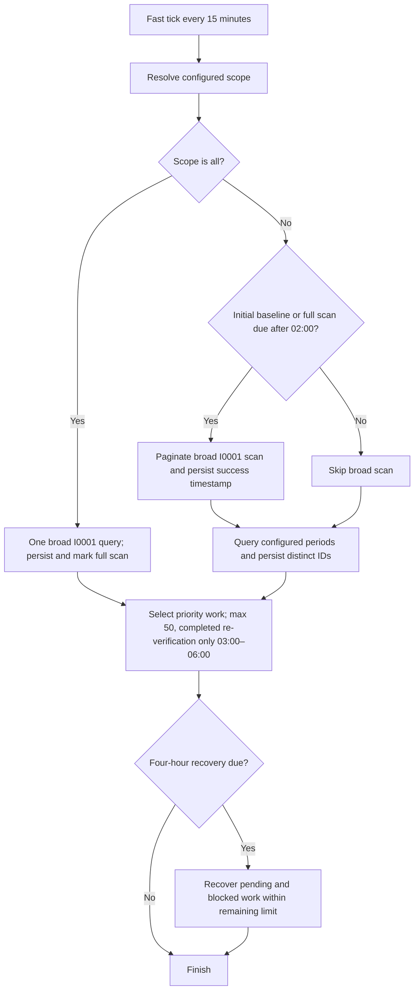

# Technical overview

## Components

`index.js` composes the web application, optional LTI provider, and trigger mode. `src/sectionAssociations/runtime.js` builds the OAuth service-account client, Mongo-backed rate-limited transport, store, reconciler, and service; the web and one-shot cron entrypoints share this runtime.

`client.js` contains bounded bookmark pagination and feature-specific API calls. `rules.js` enforces the association code and child suffix patterns. `resolver.js` validates every direct Group child and resolves exact Course Offering codes. `reconciler.js` validates every target before writes, then performs GET → full PUT → verification GET. `store.js` tracks association metadata, positive reconciliation evidence, baseline audit state, successful full-discovery timestamps, and the shared worker lease. `service.js` handles period-aware discovery, bounded priority selection, and fast/recovery passes.

For scheduling, `client.js` accepts the broad `I0001` query or a validated four-digit period plus `-I0001`; `config.js` parses and validates `SECTION_ASSOCIATION_DISCOVERY_PERIODS`, and `service.js` resolves the configured scope and coordinates full, fast, and maintenance-window selection. `store.js` performs batched discovery persistence and stores full-scan completion and recovery state. `cron.js` enforces the shared 50-item invocation limit, while `scheduler.js` provides internal timers; both use the same distributed lease.

The LTI provider is optional during bootstrap. Worker code uses only the Server-to-Server OAuth service account.

When configured, the LTI launch page groups availability and worker state, shows the actual discovery period codes in bold or “All periods”, and presents latest date and outcome. It omits the latest Source field and suppresses a zero-work message that is already clear from the history counts. History replaces its visible source column with `Periods / Scope`, preserving source in storage and CSV. Rows display recorded scope; `Mixed` is appended when discovery ran with other activities. Historical-only and re-verification-only runs show their activity labels, while old or incomplete records without scope evidence show `—`. The six-column desktop table switches at 720px of history-container width to two-line rows, then at 560px to cards with date/outcome, scope, and a three-column counter grid. Viewport breakpoints at 860px and 620px provide fallback behavior. Date filters stack vertically within narrow history panels; Service Status also stacks when its own panel is narrow. Desktop execution summaries have 20px vertical padding. Expanded rows keep concise work information and duration or failure explanations, with scope already represented in the main row. Successful zero-work rows show “No work required” and duration. Refresh and Export History CSV remain available; the latter downloads all retained runs. Success feedback clears automatically, while errors remain announced accessibly. Execution IDs, coverage, and historical backlog stay in persisted summaries and CSV but are omitted from the page. Each request sends the launch-generated ltijs token in the `Authorization: Bearer` header and same-origin credentials. ltijs validates the token and session cookie before the route checks the verified deployment ID. The status endpoint reads the latest summary and latest 50 history documents from `section_association_meta`. Each execution is stored as a separate history document keyed by tenant and execution ID; upsert makes repeated writes with that ID idempotent. No history pruning or TTL is applied. The latest-summary document remains selected by start timestamp across sources. Automatic internal/cron and manual one-shot executions share the schema and history.

The history query index is `{ namespace: 1, history: 1, startedAt: -1, executionId: -1 }` and is created during store initialization. Existing data needs no migration; MongoDB creates the index on the next store initialization. CSV export streams all history documents through a cursor in batches of 500, formats the stored execution fields on demand, and does not create a permanent report. The CSV route uses the same LTI session and deployment verification as status. History consumes storage indefinitely until an operator applies normal MongoDB storage policies or capacity constraints; there is no application count limit or TTL.

The Execution History interface displays 50 records per page and queries MongoDB with `skip`/`limit` plus one lookahead record; ordering is `startedAt` descending and `executionId` descending. Optional From and To filters query `startedAt` directly using inclusive São Paulo calendar dates converted to local-midnight UTC boundaries. Filter changes return the interface to page 1. The status response includes `history.page` and `history.hasMore`; malformed pages/dates and reversed ranges receive HTTP 400. Export History CSV remains a separate cursor over all retained history, unaffected by page or date filters. Detailed report links remain attached to each displayed execution and work on every page. Pagination and filtering add no retention or deletion policy.

The summary contains a UUID, `source`, start/completion dates, final status, optional association-level counters and coverage metadata, plus optional `discoveryPeriods` (`mode`, `periods`, and automatic `previous`, `current`, `next`) and `discoveryActivities` markers (`periods`, `historical`, `reverification`). Scope is recorded after all configured period queries complete; historical discovery is marked only after the broad query succeeds; re-verification is marked when a re-verification item is processed. Cron summaries combine evidence from their fast and recovery passes. Failed/incomplete runs retain only evidence collected before failure, and legacy documents are not backfilled. The history CSV appends period identifiers and activity labels after the existing columns; source and all previous fields retain their names and positions. Duration is calculated from the recorded start and finish times in the page. The UI does not surface coverage or backlog; these persisted values remain available in CSV export. The web process receives no external cron expression/timezone, so next execution is reported unavailable. Summary-write failures are safely logged. Current worker activity comes from the in-process scheduler or shared cron lease. The UI exposes no operation that mutates course offerings.

## Reconciliation algorithm

1. Require association Course Offering type and code `^\\d{6}-\\d{2}-\\d{4}-I0001$`.
2. Read bounded child pages. Require at least one child; every child must be Type `Group` and end with `-\\d{5}`.
3. Derive each original Course Offering code by removing the five-digit child suffix; reject duplicate derived codes.
4. Resolve every derived code exactly once and require a distinct Course Offering ID.
5. GET and validate all current targets and build safe full update payloads before the first write.
6. Leave inactive targets unchanged. In dry-run report active targets and keep the association pending. In live mode re-read each active target immediately before PUT, change only `IsActive`, then read back and verify.
7. Mark complete only after every target is confirmed inactive. Store `lastReconciledAt`, `lastVerifiedAt`, and `reconciliationVersion` as positive evidence. Block validation failures; leave transient/uncertain work retryable.

The PUT body preserves all current Course Offering fields and converts Brightspace RichText Description to RichTextInput. An uncertain PUT is read back and never blindly replayed.

## Baseline, eligibility, and scheduling

`SECTION_ASSOCIATION_DISCOVERY_PERIODS` is optional. An undefined value, explicitly empty value, or case-insensitive `auto` uses `Intl.DateTimeFormat` in `America/Sao_Paulo` to resolve previous/current/next. January–June maps to `YY01`, July–December to `YY02`; previous and next roll across years. October 2026 resolves to `2601`, `2602`, `2701`; February 2027 to `2602`, `2701`, `2702`; August 2027 to `2701`, `2702`, `2801`. A comma-separated list (for example `2601,2602,2701`) selects exactly those periods after trimming and deduplication; a single period such as `2701` is also valid. Only `all` selects broad discovery every fast cycle. Keywords are case-insensitive, and malformed values fail startup. In Render, remove the setting, leave it empty, or use `auto` for automatic discovery; use `all` for all-period discovery. Period configuration selects Brightspace offerings to query; it does not restore an association that a failed IPSIS import never created.

Auto and explicit fast passes make a fully paginated Brightspace request for each selected period:

```text
GET /d2l/api/lp/{version}/orgstructure/?orgUnitType=3&orgUnitCode={period}-I0001
```

The broad `orgUnitCode=I0001` scan is fully paginated and covers all historical and future periods, finding associations outside the regular scope without repeating that broad read every 15 minutes in auto/explicit modes. The first broad query initializes the baseline. Later full scans are due once daily at or after 02:00 local time. Their successful completion is timestamped in tenant-scoped `section_association_meta` only after records persist; missed executions remain due at the next invocation. If a broad query fails on an established tenant, its timestamp stays unchanged and regular period discovery continues; initial baseline failure stops the cycle. Mongo persistence failures fail the cycle and do not mark completion. In `all` mode, each fast cycle runs one broad query, persists its discoveries, and uses the same result as full discovery, avoiding a duplicate query.

The first successful full discovery uses a Mongo baseline lease and marks associations already present as `baseline: true` for audit. Baseline does not suppress reconciliation. Historical and new associations go through the same reconciler; historical work has no new-association stability delay. New associations wait the configured stability duration.

Each scheduled run processes at most `SECTION_ASSOCIATION_FIX_MAX_RECONCILIATIONS_PER_RUN` (default 50), in deterministic priority order: stable new/pending work, historical baseline work, and controlled blocked retries. Cron passes the fast discovery result into its recovery pass so discovery is not repeated within one invocation; fast plus recovery share the 50-item limit. Legacy completed records without positive verification evidence remain eligible automatically. Verified completed records become eligible every `SECTION_ASSOCIATION_FIX_COMPLETED_REVERIFY_HOURS` (default 24), but the selector includes them only from 03:00 through 06:00 `America/Sao_Paulo`. New/pending and blocked work remains eligible throughout the day and has priority over completed verification. A remaining completed backlog resumes on later 15-minute invocations in the next maintenance window. If a target is active again, normal validation and safe read-back verification apply.

Cron mode runs one bounded fast pass per external invocation and uses persisted `lastRecoveryAt` to keep the four-hour pending/blocked recovery schedule independent. The recovery pass reuses the fast pass's discovery and consumes only the remaining part of the shared 50-reconciliation limit. Internal mode runs immediate and recurring fast/recovery timers through the same service functions. Both modes acquire and renew the same namespaced Mongo worker lease and await release; this prevents overlapping scans and reconciliation across cron/internal instances, with lease expiry providing crash recovery.

Completed associations with positive verification evidence become eligible after the configured 24-hour interval, but only the fast selector includes them between 03:00 and 06:00 `America/Sao_Paulo`. They use the same bounded validation and reconciliation path. Pending, historical, and retryable blocked work retains priority and remains eligible outside that window. A completed-work backlog is served in available capacity during the window and resumes in the next window if needed; each verified result updates its existing verification timestamp, so completed work is not needlessly repeated. No additional Render job or timezone setting is required, and automatic period rollover needs no manual maintenance.



## Persistence

`section_associations` is keyed by tenant namespace and `associationOrgUnitId`. It stores association code, first/last seen and checked times, status, audit baseline marker, safe errors, compact outcomes, and positive verification evidence. `section_association_meta` stores baseline coordination, cron lease/recovery metadata, and the last successful broad discovery timestamp. Mongo is an operational work ledger; current Brightspace records remain authoritative.

After the baseline is ready, discovery deduplicates valid association IDs and compares them with Mongo in tenant-scoped `$in` queries of at most 500 IDs, supported by the existing unique `{ namespace: 1, associationOrgUnitId: 1 }` index. Known records receive a bounded bulk refresh of `associationCode` and `lastSeenAt`; inserts are limited to IDs absent from the comparison and use bounded unordered bulk upserts with `$setOnInsert`, preserving existing state, first-seen time, baseline marker, and reconciliation evidence. Duplicate-key races are confirmed against Mongo and counted as already known. Initial baseline writes are chunked to the same bound and still mark only inserted records as baseline. Counters count distinct valid discovered IDs. A partial bulk failure fails the execution so it cannot be reported as complete; already-applied operations are safe to observe on the next cycle.

## Transport and write boundary

JWT exchange is shared with the application. Brightspace URLs remain HTTPS on the configured origin; redirects are disabled, request timeouts are bounded, API traffic passes through the shared rate gate, and errors omit credentials. The feature's only write is a narrowly scoped Course Offering PUT.

## Detailed execution audit

Each scheduled or manual execution passes its UUID and source into the shared reconciler. After a PUT is verified inactive, it upserts one `correction` record into `section_association_audit`; the stable key is execution, parent association, and target offering. Validation blocks, update failures, verification failures, and unexpected association failures produce deduplicated `exception` records with sanitized explanations. Corrections are target-level; the existing `correctionsApplied` value remains association-level (at least one verified target update). Audit write failures mark execution detail coverage incomplete, and completed writes remain persisted if a later operation fails.

The audit collection has a unique `{ namespace: 1, executionId: 1, kind: 1, recordKey: 1 }` index and an execution retrieval `{ namespace: 1, executionId: 1, kind: 1 }` index, created at store initialization. LTI Corrections CSV and Exceptions CSV endpoints require the same verified session and deployment check as history export. They stream rows from Mongo on demand, safely escape CSV/formula content, and make no Brightspace calls. Empty reports have headers. Only summaries marked `detailedAuditAvailable` show report actions; older executions without that marker are explicitly unavailable, not treated as zero. No TTL or application retention cap is applied; storage follows MongoDB capacity and operator policy. No migration is required.

Reconciliation diagnostics use stages `association-read`, `children-read`, `exact-code-lookup`, `target-read`, `target-update`, and `verification-read`. A Brightspace HTTP failure retains its status; known timeout/network errors and OAuth failures use separate stable reasons without inventing a status. Render reconciliation failure lines include the stage, safe API endpoint identifier, reason, and available status. Exception rows classify failures as `read-failed`, `update-failed`, `verification-failed`, `validation-blocked`, or `processing-error`; explanations identify the failed operation and include the known HTTP status and target Org Code/ID. Available association and target names are stored from already-read records. No additional Brightspace calls are made for diagnostics. Operators use the execution's Exceptions CSV; expanded history rows continue to display the existing persisted run summary explanation.

## API Health Check

`apiHealthInventory.js` is the dated source of truth for six logical operations in `client.js`. Discovery and exact-code resolution share the Org Unit list route but have distinct purposes and query parameters; Course Offering GET and PUT remain distinct methods. The OAuth service-account token exchange is separately recorded as an authentication diagnostic sourced from `BS_OAUTH2_TOKEN_ENDPOINT`, not a versioned LP/LE operation. The automated inventory test executes every client method and compares normalized method/route shapes, including the discovery query distinctions.

The current evidence verification date is 2026-10-19. The official D2L lifecycle page lists LP 1.49 as oldest fully supported, LP 1.46–1.48 as deprecated, and LP 1.45 and older as obsolete. It documents LP 1.49+ route support for these Org Unit and Course Offering calls. The Course Offering update has an additional endpoint contract constraint: `IsActive` is required from LP 1.59 and unsupported earlier, so 1.59 is recorded as the minimum for the application's update operation. Minimum versions are stored per endpoint; do not generalize them to unrelated routes. Lifecycle evidence becomes stale after 90 days and is then Unknown until the inventory evidence date and source are reviewed. The inventory provides official D2L resource, routing, API properties, and version lifecycle links.

`apiHealth.js` uses the existing service-account OAuth, `createBrightspaceGet`, and Mongo-backed rate-limited HTTP client. Each assessment validates `GET /d2l/api/lp/versions/` and `POST /d2l/api/versions/check`; neither call performs a Course Offering mutation. Version health is calculated from configured version, the tenant's supported list/check response, local lifecycle evidence, and each operation's verified minimum. Unsupported or below-minimum versions are Critical, obsolete versions are Critical, deprecated versions are At Risk, lower-but-supported versions are Update Available, and current supported versions are Healthy. Missing or stale evidence yields Unknown. Contract Verification remains a separate `Not Verified` field because checking tenant version support does not exercise every endpoint payload or response contract.

The service stores current state and the last successful result in a tenant-namespaced `section_association_meta` document. It keeps last-attempt status and sanitized error code/status even on failure and appends successful assessments to a 30-entry bounded history. A Mongo lease coordinates manual and automatic checks; manual requests also atomically reserve the five-minute cooldown. Failed attempts preserve the previous result but set current health to Unknown. Cached state is stale after 36 hours or an inventory revision change and returns Unknown endpoint counts until a current assessment succeeds.

Cron mode starts a due check at the end of the existing invocation, after reconciliation and maintenance-summary persistence finish. Internal mode checks after the existing fast tick and its summary are saved. These checks cannot fail or change reconciliation status, counters, or elapsed summaries, and they run after operational API work so they do not contend for the shared Brightspace rate limiter during reconciliation. Due checks run once per Sao Paulo calendar day after 02:00; no Render job or interval is added. Manual requests call the same service and Mongo lease. The LTI GET route only reads Mongo; the POST route verifies the LTI token's configured deployment, then requires an HTTPS same-origin `Origin`, same-origin Fetch Metadata when present, and `X-Requested-With: XMLHttpRequest`. Both routes disable caching. No token, private key, raw header, or request URL is persisted.

If a Brightspace endpoint, method, configured version source, OAuth scope, or contract changes, update the inventory, its source-coverage and assessment tests, and the operating documentation. Do not treat the endpoint `contractVerification` label as proof of a live contract test.
